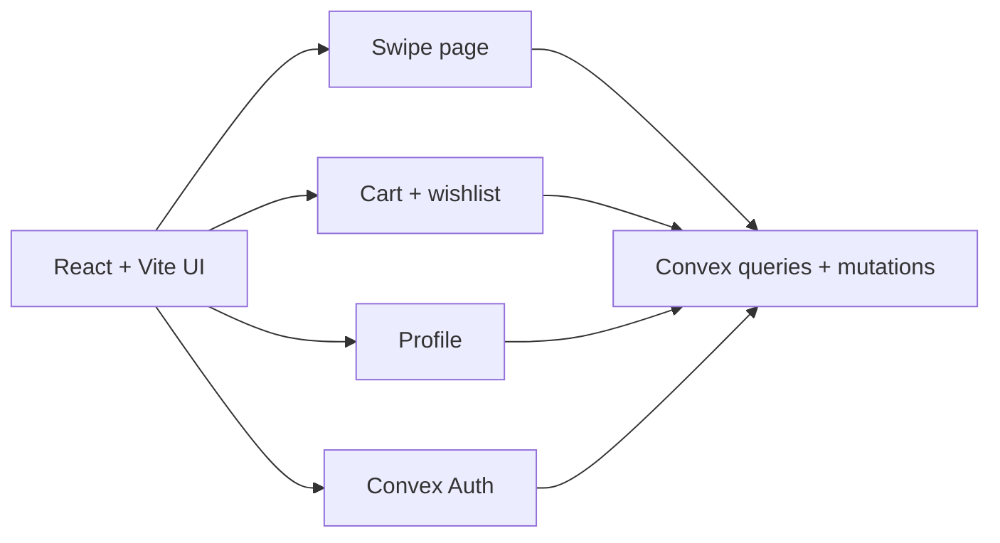

# Style Swipe

> Status: Active prototype — local development. This is a full-stack product-discovery concept, not a published commercial store.

Style Swipe is a swipeable fashion-discovery prototype with product browsing, liking, cart, wishlist, profile, and authentication screens. The frontend uses React, TypeScript, Vite, React Router, Tailwind, Shadcn UI, and Framer Motion. Convex provides backend data and authentication.

## Architecture



## Features

- email OTP and anonymous sign-in
- card-based product discovery
- cart and wishlist flows
- authenticated profile area
- responsive neobrutalist interface styling

## Getting started

```bash
pnpm install
pnpm dev
```

Configure `CONVEX_DEPLOYMENT` and `VITE_CONVEX_URL` for the client, plus Convex backend environment variables for authentication. Do not commit real keys.

## Repository scope

The app is intended as a portfolio prototype. Internal editor tooling, scratch files, and AI coding instructions have been removed from the maintained codebase.

Built by [Aaron James](https://www.linkedin.com/in/aaron-james-9703a6388/).
